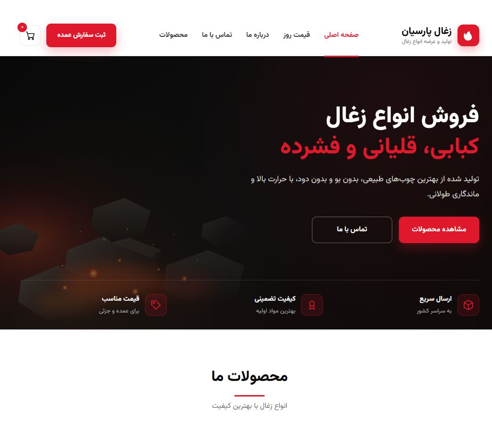

# زغال پارسیان

قالب فروشگاهی وردپرس برای فروش زغال؛ فارسی، راست‌به‌چپ و سازگار با ووکامرس.

طراحی اختصاصی با تم قرمز/مشکی، بدون صفحه‌ساز و بدون وابستگی به قالب مادر.



## ویژگی‌ها

- طراحی اختصاصی و کاملاً RTL با فونت وزیرمتن
- هدر چسبان، هیرو تیره با تصویر زغال، بنر «فروش عمده زغال»
- کارت محصول با قیمت، دسته‌بندی و دکمه‌ی افزودن به سبد
- سازگاری کامل با ووکامرس: فروشگاه، محصول، سبد خرید، تسویه حساب و حساب کاربری
- واحد پول «تومان» و پشتیبانی از آپلود SVG به‌صورت داخلی
- بخش مزیت‌ها، نظرات مشتریان، سوالات متداول و فوتر ۴ ستونه با نقشه
- صفحه‌های آماده: درباره ما، تماس با ما، قیمت روز
- تنظیمات تلفن، آدرس، شبکه‌های اجتماعی و متن‌ها از سفارشی‌ساز وردپرس
- ریسپانسیو و بهینه برای موبایل

## پیش‌نمایش

فایل [`preview.html`](preview.html) یک نسخه‌ی استاتیک از صفحه‌ی اصلی است و بدون نیاز به وردپرس در مرورگر باز می‌شود.

## نصب سریع

1. از بخش **Releases** فایل `zoghal-parsian.zip` را دانلود کن.
2. پیشخوان وردپرس → **نمایش → پوسته‌ها → افزودن پوسته → بارگذاری پوسته** → نصب و فعال‌سازی.
3. افزونه‌ی **WooCommerce** را نصب و فعال کن (کشور: ایران، واحد پول: تومان).
4. محصولات را با فایل [`docs/woocommerce-products.csv`](docs/woocommerce-products.csv) درون‌ریزی کن.
5. منو، برگه‌ها و اطلاعات تماس را تنظیم کن.

راهنمای کامل: [`docs/INSTALL-FA.md`](docs/INSTALL-FA.md)

## ساختار پروژه

```text
zoghal-parsian/
├── style.css                  مشخصات قالب (WordPress)
├── functions.php              راه‌اندازی قالب، منوها و امکانات
├── header.php / footer.php    هدر و فوتر
├── front-page.php             صفحه اصلی (هیرو، محصولات، مزیت‌ها، ...)
├── index.php / page.php / single.php / archive.php / 404.php
├── inc/
│   ├── customizer.php         تنظیمات سفارشی‌ساز
│   └── woocommerce.php        یکپارچه‌سازی ووکامرس
├── assets/
│   ├── css/main.css           استایل اصلی
│   ├── js/main.js             منوی موبایل و تعامل‌ها
│   └── img/                   تصاویر SVG
├── docs/
│   ├── INSTALL-FA.md          راهنمای نصب
│   ├── woocommerce-products.csv
│   └── screenshot-home.jpg
├── preview.html               پیش‌نمایش استاتیک
└── LICENSE                    GPL-2.0
```

## استک

- WordPress 6.4+
- WooCommerce
- PHP 7.4+
- CSS Grid / Flexbox خالص
- فونت Vazirmatn

## توسعه محلی

پوشه‌ی قالب را در `wp-content/themes/zoghal-parsian` قرار بده و آن را فعال کن.
برای اجرای سریع بدون نصب دستی، می‌توان از `preview.html` برای بررسی ظاهر و از یک نصب وردپرس محلی برای تست ووکامرس استفاده کرد.

## لایسنس

این پروژه تحت لایسنس [GPL-2.0-or-later](LICENSE) منتشر شده است.

## سازنده

[VELTRIX STUDIO](https://veltrixstudio.ir)
